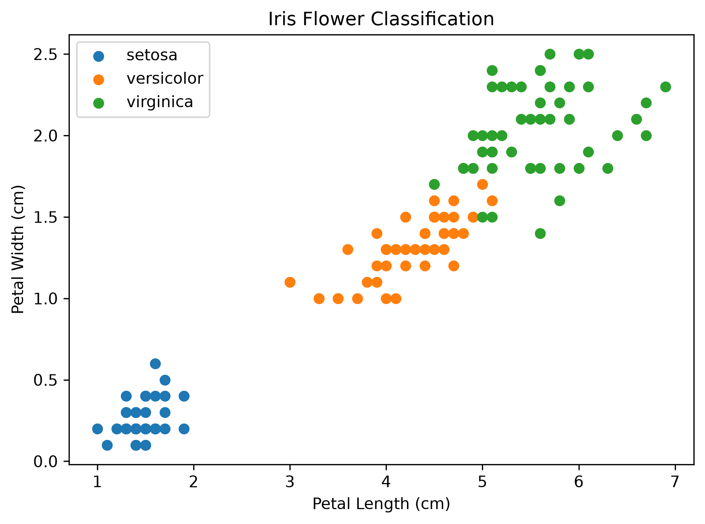
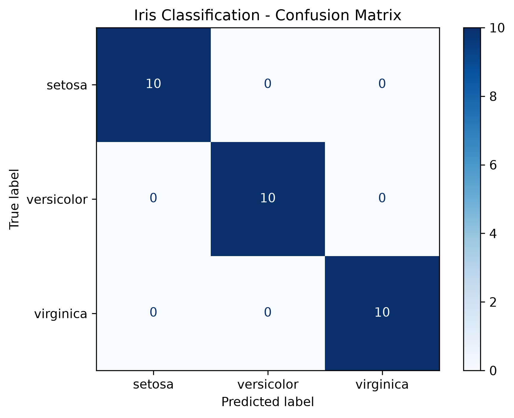

# Iris Flower Classification Using Machine Learning

## About the Project
This beginner-friendly machine learning project predicts the species of an Iris flower using its measurements.

The project uses the K-Nearest Neighbors (KNN) algorithm to classify flowers into three species: Setosa, Versicolor, and Virginica.

## Objectives
- Understand the basics of machine learning.
- Explore and analyze a dataset.
- Train and test a classification model.
- Make predictions for a new flower.
- Visualize flower measurements.

## Dataset
The Iris dataset is loaded from Scikit-learn. It contains 150 flower samples with four features:

- Sepal length
- Sepal width
- Petal length
- Petal width

The target consists of three Iris flower species.

## Technologies Used
- Python
- Pandas
- Matplotlib
- Scikit-learn
- K-Nearest Neighbors (KNN)

## How to Run the Project

### 1. Clone the repository
Download or clone this repository to your computer.

### 2. Install the required libraries
```bash
python -m pip install -r requirements.txt
```

### 3. Run the Python file
```bash
python iris_classification.py
```

## Machine Learning Workflow
1. Load the Iris dataset.
2. Explore the flower measurements.
3. Split the dataset into training and testing sets.
4. Train the KNN classifier.
5. Evaluate the model using accuracy.
6. Predict the species of a new flower.
7. Visualize the flower measurements.

## Learning Outcome
This project helped me understand the basic machine learning workflow, model training, classification, prediction, and evaluation.

## Author
Sruthy Sundar

## Visualization



## Confusion Matrix

